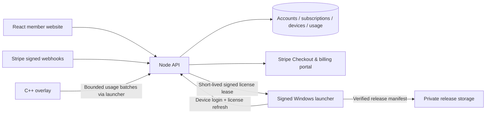

# Dryad subscription and licensing architecture

> This is the original design proposal. For current implementation status, selected $5.99/$48.16 pricing, the five-day device reset policy, builds, tests and remaining production work, use [DRYAD.md](DRYAD.md). Statements below describing future work refer to the first prototype.

## Recommended shape

Start with one Node service, one relational database, a React website, and a small signed Windows launcher. Split billing, licensing, identity, telemetry, and release delivery into modules within the service. Separate services would add operational work without helping the first release. SQLite suits this local prototype; use PostgreSQL for production instances and transactional enforcement across processes.

Solid arrows describe the intended design; the launcher, overlay reporting, private release storage, and lease endpoint are **future work**. The current build implements website identity, account views, local persistence, and Stripe test integration.

## Account and payment flow

1. A user registers/signs in through the website. Web sessions use HttpOnly cookies; native client credentials must be a separate token system. Before selling, add verified email, password recovery, optional MFA, and account recovery/support tools.
2. The API creates a hosted Stripe Checkout Session for an allowlisted price, connected to the user's stored Stripe customer. Prices, user IDs, and subscription state never come from browser claims.
3. A verified webhook causes the API to retrieve current Stripe state and update the local subscription. A return redirect is a user experience event, not evidence of payment. The account can display “confirming” while the webhook is in flight.
4. The portal manages renewal cancellation, card updates, and invoices. A scheduled cancellation keeps access until the paid period ends; canceled, expired, unpaid, and past-due states do not qualify for a new lease under the initial strict policy. Any payment grace period should be an explicit product policy.
5. For launch, run durable webhook jobs with retries and dead-letter alerts, per-subscription serialization, reconciliation against Stripe, and transactional processed-event records. Fetching current state limits stale event effects but is not a substitute for serialized updates in a multi-worker deployment. Handle missing customer mappings with reconciliation, never by granting access speculatively.
6. Add explicit refund/dispute policy and event handling before live payments. Payment terms, final pricing, taxes, support contact, and privacy policy need to be settled before checkout is offered publicly.

## Native login and license leases

- Use browser-based native authorization with PKCE (or an established device authorization flow), so passwords never need to live in the DLL. Show the account and device name during pairing. Store refresh credentials in Windows Credential Manager / DPAPI; hash server-side refresh tokens and rotate them on use.
- Generate an installation key pair on the client. Register its public key through the authenticated launcher flow and prove possession on refresh. A one-device rule is enforced by a database transaction, not only by the website's device counter.
- A license endpoint checks account state, paid-through time, permitted product/version, device slot, and revocation. Return a signed lease with `sub`, device key ID, product, audience, license version, issued/expiry times, and a nonce. Suggested initial lease: 10 minutes, refreshed after 5. These timings should be tested against normal connection loss.
- Keep the signing private key on the server; bundle only verification public keys, with key IDs for rotation. TLS protects transport. Do not embed a reusable server API secret into the DLL.
- Define a small bounded offline grace policy. On expiration or revocation, stop scheduling new script actions at a safe boundary and release held input. Never crash the game or strand an in-progress input sequence. Server authorization cannot make arbitrary local code unmodifiable; this is a practical access-control system.
- Removing a device revokes its refresh credential and blocks lease renewal; an already-issued lease lasts only until its short expiry. Add reset cooldowns and support-assisted recovery so Windows reinstalls do not lock out legitimate subscribers.

The current API's web cookies are **not** launcher credentials, and `/api/account/devices` is not yet a complete device licensing API.

## DLL distribution and obfuscation

Ship a small signed launcher and signed, versioned overlay packages from private object storage. After license verification, the API can issue a short-lived download URL and a signed manifest containing the release version, platform, size, hash, and signing key ID. The launcher verifies signature and hash before loading. Preserve rollback and a kill switch for broken releases. Keep stable and preview channels separate.

Sending the DLL at runtime still transfers its bytes to a machine controlled by the customer. Decrypted code can be inspected in memory. Removing the normal DLL file from distribution does not provide a strong security boundary and creates installation, update, debugging, and reliability complexity. Start with controlled downloads of conventional signed files. Do not invest in custom memory-loading machinery for the first release.

Later, selective obfuscation or watermarking can increase copying cost, especially around license checks. Keep crash diagnostics viable and benchmark impact. No obfuscation, DLL modifications, runtime loader, or anti-debugging was added in this phase. Keep valuable server-held state and authority on the backend; never depend on a hidden string or client-side check alone.

## Hardware/device tracking

Use **installation identity first, hardware signals second**. A stable installation key is more recoverable than a raw HWID. If hardware signals are needed for abuse detection, disclose the purpose and retention period, derive a normalized fingerprint locally, and store only a server-keyed HMAC digest. Treat both the digest and its source as sensitive identifiers. Do not store or display raw disk/motherboard serials or create an invasive cross-product fingerprint.

Fingerprints are spoofable and change after repairs, VMs, firmware updates, and reinstalls. Use a limited reset policy and manual review for unusual activity rather than automatic bans based on one changed component. Show friendly device names and last-seen time in the account page. Production requires separate device records, refresh-token revocations, and reset/audit events; this prototype stores only names and last-seen timestamps.

## Usage reporting

The overlay already has local session counters in `src/session_metrics.h`. Add a versioned reporting adapter through the launcher rather than tightly coupling billing code into farming logic. Send small asynchronous batches: session ID, monotonic sequence, script identifier/version, timestamps, runtime seconds, completed runs, verified resource gains, and upgrade counts. Authenticate each batch with the device credential and check the active account/device. Use unique `(device, session, sequence)` keys to deduplicate retries, validate bounds, and tolerate offline buffering.

Keep raw events for a bounded retention period and aggregate daily usage for dashboard queries. Distinguish resource gains from current balances and account for verified wall spending consistently with the overlay's metrics. No screenshots, game credentials, or raw input logs are needed. Usage is client-reported and may be manipulated; do not treat it as proof of billing, security, or entitlement. Website analytics ingestion must never grant a subscription.

The current site stores demo aggregate rows and shows empty usage for real accounts. It deliberately has no anonymous or browser-writeable telemetry ingestion endpoint.

## Data model and service boundaries

| Module | Prototype | Production additions |
| --- | --- | --- |
| Identity | users, hashed sessions, scrypt passwords | Email verification, recovery, MFA, token families, audit events |
| Billing | Stripe customer IDs, subscriptions, processed events, pending checkout | Durable jobs, reconciliation, refund/dispute state, cross-instance locks |
| Licensing | Architecture only | Entitlements, installation public keys, leases, revocations, reset policy |
| Devices | Owned records, sample device, removal | Pairing challenges, device-bound refresh credentials, reset history |
| Usage | Account-scoped read API, demo aggregates | Authenticated ingest, deduplication, validation, daily aggregation, retention |
| Releases | Architecture only | Signed manifest, private objects, short-lived URLs, rollout/rollback |

Keep Stripe secrets, signing keys, database credentials, and device HMAC keys in server-side secret storage. Deploy behind HTTPS, configure trusted proxy handling deliberately, move rate limits/locks to shared storage when scaling, and back up the database with restore tests. Production demo mode is disabled; live Stripe keys are refused in this prototype until the live-payment readiness work is done.

## Suggested next increments

1. Review branding, proposed price points, device allowance, cancellation/refund terms, and feature copy. Replace the three concept videos with actual captures.
2. Connect Stripe test credentials and perform a full hosted Checkout + portal + renewal/cancellation cycle. Automated tests currently use mocked Stripe calls and real signature verification.
3. Implement native browser login, device pairing, lease refresh, safe expiry, and session revocation. Add the device/key tables first.
4. Connect verified overlay metrics and daily aggregates; add authenticated release manifests and controlled downloads.
5. Finish recovery, operational monitoring, production storage/queues, privacy controls, and payment policies before accepting live subscribers. Evaluate selective obfuscation only after the license flow is reliable.

References: [Stripe subscription Checkout](https://docs.stripe.com/billing/subscriptions/build-subscriptions?platform=web&ui=stripe-hosted), [Stripe webhook signatures](https://docs.stripe.com/webhooks/signature), [Stripe customer portal](https://docs.stripe.com/customer-management), [Node SQLite API](https://nodejs.org/api/sqlite.html).
